# 🌾 Rabi Crop Doctor (फसल मित्र - रबी)

**A Free, Offline-First Machine Learning & Artificial Neural Network (ANN) Crop Disease Classifier & Field Incidence Tool for Indian Rabi Farmers — Packaged as a Ready-to-Install Android APK (`RabiCropDoctor.apk`)**

[](LICENSE)
[](https://lunganlungpg.github.io/rabi-crop-doctor/)
[-15803D.svg)](https://github.com/lunganlungpg/rabi-crop-doctor/releases/latest)
[](PACKAGES.md)
[](https://github.com/lunganlungpg/rabi-crop-doctor/actions/workflows/ci.yml)
[-0284C7.svg)](ROADMAP.md)
[](CONTRIBUTING.md)
[](#key-features-for-farmers)
[](#ml-vs-ann-classification-benchmark)

---

## 🎯 Purpose & Agricultural Context

Rabi season crops across northern, central, and eastern India (**Wheat, Mustard, Chickpea, and Potato**) suffer rapid yield losses from foliar fungal, oomycete, and soil-borne diseases between **December and March**:
- **Wheat (गेहूँ):** Yellow / Stripe Rust (*Puccinia striiformis*) & Brown / Leaf Rust (*Puccinia triticina*)
- **Mustard (सरसों):** Alternaria Blight (*Alternaria brassicae*) & White Rust (*Albugo candida*)
- **Chickpea (चना):** Ascochyta Blight (*Ascochyta rabiei*) & Fusarium Wilt (*Fusarium oxysporum*)
- **Potato (आलू):** Early Blight (*Alternaria solani*) & Late Blight (*Phytophthora infestans*)

Smallholder farmers rarely have reliable rural internet connectivity or paid diagnostic tools in the field. **Rabi Crop Doctor** combines transparent computer vision phenomics, **Machine Learning (Random Forest + RBF SVM)**, and **Artificial Neural Networks (MLP ANN + Deep Regularized ANN)** inside a **zero-dependency offline Android APK** and bilingual **English / हिन्दी** progressive web application.

---

## 📱 Key Features for Farmers (Android APK)

1. **Hybrid Offline + Bring-Your-Own-Key Gemini AI Vision:** Runs 100% offline inside the Android APK (`android_build/` -> `RabiCropDoctor.apk`, minSdk 21 / Android 5.0+ through Android 15) **and** lets users optionally paste their own **Google Gemini API key** on-device, verify/load live Gemini models, and select one or multiple AI models (`Flash`, `Flash-Lite`, `Pro`, or custom IDs) for multi-model vision diagnosis and bilingual advice with automatic offline fallback.
2. **Native Camera & Gallery Integration:** Supports direct camera capture with automatic EXIF orientation correction, Android Gallery photo selection, and 12 offline demo leaf presets.
3. **AI Lesion Heatmap & Severity Grading (0–5):** Automatically segments the leaf blade from soil/sky backdrops, highlights chlorosis, yellow rust stripes, white blisters, and blight necrosis in an instant side-by-side map, and estimates foliar lesion percentage.
4. **Plot-Level Disease Incidence (%) & Wheeler PDI Audit:** Add inspected field leaves across a W-pattern survey to calculate:
   - $\text{Disease Incidence (\%)} = \frac{\text{Infected Leaves}}{\text{Total Leaves Inspected}} \times 100$
   - $\text{Percent Disease Index (PDI, Wheeler 1969)} = \frac{\sum \text{Grade}_{0-5}}{\text{Total Leaves} \times 5} \times 100$
   Export CSV to Downloads, share summaries via WhatsApp/ShareSheet, or print PDF reports directly from Android.
5. **Bilingual English & हिन्दी Interface + KVK Guidelines:** Actionable IPM guidance and toll-free **Kisan Call Centre (`1800-180-1551`)** reminders.

---

## 📊 Visual Results & Benchmark Analysis

### 1. RabiLeaf-1440 Botanical Image Benchmark (12 Classes)
1,440 synthetic-field botanical leaf images (`128×128` RGB, 120 per class) synthesized with varying Indo-Gangetic soil, dry straw, and sky backdrops, crop-specific leaf morphology, rotation invariance, and graded lesion severity:


### 2. Real-Photo Rabi Samples (`Kaggle 20k+` Selective Wheat Subset, CC0-1.0)
Curated real-field sample photos from [`jawadali1045/20k-multi-class-crop-disease-images`](https://www.kaggle.com/datasets/jawadali1045/20k-multi-class-crop-disease-images) (**CC0-1.0 Public Domain**), selectively filtered for Rabi crops active under [`ROADMAP.md`](ROADMAP.md) (`Q1: wheat, mustard, chickpea, potato` — of which `wheat` spans `11` classes / `2,101` raw images → `1,435` Train + `396` held-out Validation after duplicate removal; `51.01%` ensemble held-out acc, `0.8452` Macro ROC-AUC; see [`KAGGLE_TRAINING.md`](KAGGLE_TRAINING.md)):

| Healthy Wheat | Yellow (Stripe) Rust | Brown (Leaf) Rust | Black (Stem) Rust |
|:---:|:---:|:---:|:---:|
| [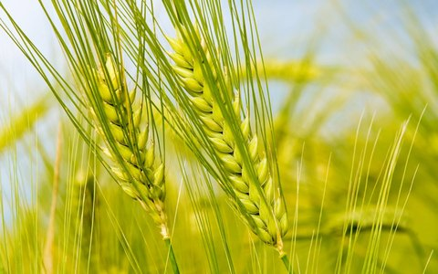](kaggle_samples/wheat_healthy.jpg)<br>`wheat_healthy` | [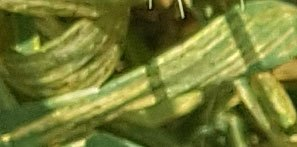](kaggle_samples/wheat_yellow_rust.jpg)<br>`wheat_yellow_rust` | [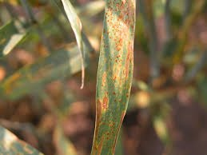](kaggle_samples/wheat_brown_leaf_rust.jpg)<br>`wheat_brown_leaf_rust` | [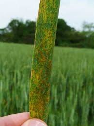](kaggle_samples/wheat_black_rust.jpg)<br>`wheat_black_rust` |
| **Wheat Leaf Blight** | **Wheat Powdery Mildew** | **Wheat Scab** | **Wheat Flag Smut** |
| [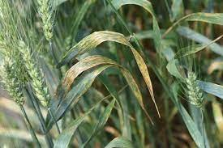](kaggle_samples/wheat_leaf_blight.jpg)<br>`wheat_leaf_blight` | [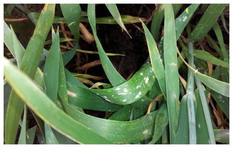](kaggle_samples/wheat_powdery_mildew.jpg)<br>`wheat_powdery_mildew` | [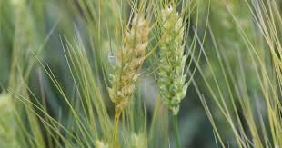](kaggle_samples/wheat_scab.jpg)<br>`wheat_scab` | [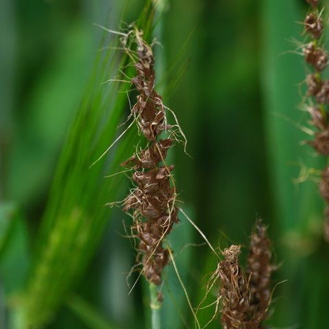](kaggle_samples/wheat_flag_smut.jpg)<br>`wheat_flag_smut` |
| **Wheat Aphid** | **Wheat Mite** | **Wheat Stem Fly** | **Quick Try (CLI)** |
| [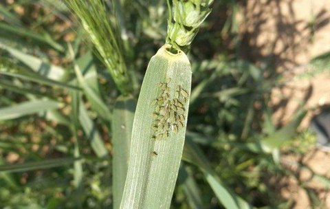](kaggle_samples/wheat_aphid.jpg)<br>`wheat_aphid` | [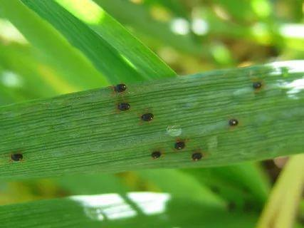](kaggle_samples/wheat_mite.jpg)<br>`wheat_mite` | [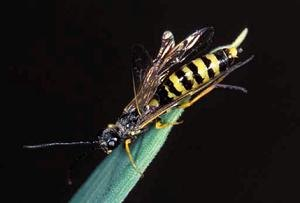](kaggle_samples/wheat_stem_fly.jpg)<br>`wheat_stem_fly` | Browse all 11 sample photos in [`kaggle_samples/`](kaggle_samples/) |

### 3. ML vs. ANN Model Performance & Convergence
Trained on a 28-dimensional plant pathology vision vector (`feature_extractor.py`), evaluated using 5-fold Stratified Cross-Validation and a held-out 20% test split ($n=288$):

| Model Architecture | 5-Fold CV Acc | 12-Class Test Acc | Farmer Crop-Mode Acc | Macro F1 | ROC AUC (OvR) |
|:---|:---:|:---:|:---:|:---:|:---:|
| **Random Forest (ML, 45 Trees)** | 85.85% | 90.62% | **98.26%** | 0.9052 | 0.9937 |
| **RBF Kernel SVM (ML, OvO + Platt)** | 82.73% | 85.76% | 95.14% | 0.8580 | 0.9939 |
| **MLP Neural Network (ANN `28→64→32→12`)** | 87.24% | 93.40% | 97.57% | 0.9339 | 0.9970 |
| **Deep Regularized ANN (`28→128→64→32→12`)** | **88.46%** | 90.97% | 96.88% | 0.9096 | 0.9962 |
| **Hybrid Ensemble (ANN + SVM + RF)** | — | **94.10%** | **98.26%** | **0.9410** | **0.9980** |

> **Why Farmer Crop-Mode matters:** When a farmer selects their known crop (*Wheat, Mustard, Chickpea, or Potato*) before scanning, within-crop disease classification accuracy reaches **97.57%–98.26%**.

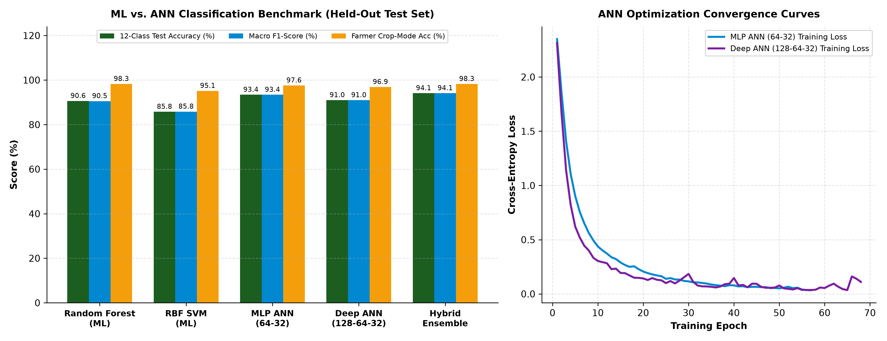

### 4. Class Confusion Analysis & Physics-Driven Features
Rotation-invariant **Structure Tensor Stripe Coherence** separates linear *Yellow Rust* stripes from scattered *Brown Rust* pustules, while **Radial Margin Lesion Bias** cleanly separates margin-invading *Potato Late Blight* from interior bullseye *Early Blight* spots:


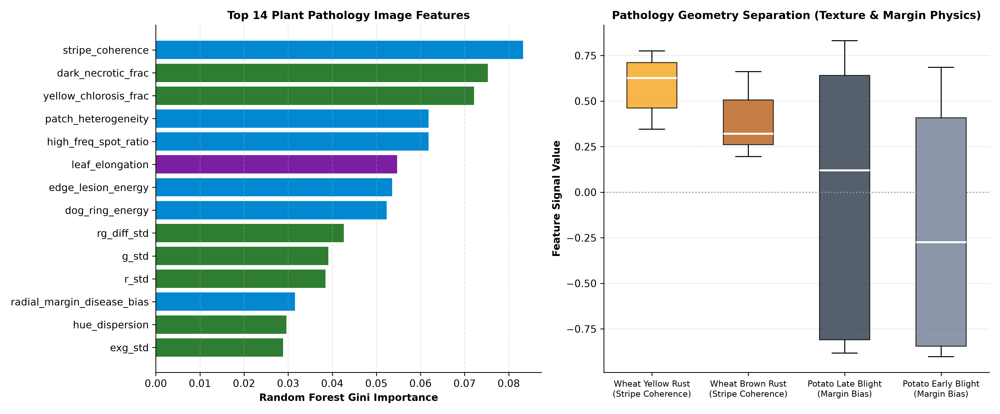

### 5. Indian Rabi Belt Disease Incidence & Weather Triggers
Regional disease incidence (%) and Wheeler PDI metrics across major Rabi-producing states (`data/rabi_field_incidence_india.csv`):


*Interactive Plotly HTML Dashboards:*
- [`plots/interactive_model_explorer.html`](plots/interactive_model_explorer.html)
- [`plots/interactive_rabi_incidence.html`](plots/interactive_rabi_incidence.html)

---

## 📁 Project Architecture

```text
rabi_crop_doctor/
├── RabiCropDoctor.apk                 # Ready-to-install signed offline Android APK (API 21–35)
├── PACKAGES.md                        # Access & install guide for Python, R, npm, Docker & APK
├── pyproject.toml                     # Installable Python package (rabi-crop-doctor + rabi-doctor CLI)
├── package.json & index.js            # @lunganlungpg/rabi-crop-doctor npm/Node offline package
├── Dockerfile                         # Container image published to ghcr.io GitHub Packages
├── ROADMAP.md                         # 1-year stress-free collaborative roadmap (Nov 2026 – Nov 2027)
├── CONTRIBUTING.md                    # Friendly co-contributor guide, parity checklist & co-author format
├── .github/                           # GitHub Actions CI, Pages, Release & Packages workflows
├── R-package/                         # Installable base-R epidemiological companion (rabidoctor)
├── build_apk.py                       # Builds APK from scratch (AAPT2 + Javac + D8 + apksigner)
├── verify_apk.py                      # Validates manifest, offline assets, and APK signatures
├── python/
│   ├── feature_extractor.py           # 28-dim leaf segmentation + pathology texture/color engine
│   ├── generate_rabi_dataset.py       # RabiLeaf-1440 benchmark generator
│   ├── train_and_evaluate.py          # Trains RF, RBF-SVM, MLP-ANN, Deep-ANN & exports JSON weights
│   ├── rabi_timeline.py               # ROADMAP.md & knowledge-base Rabi crop timeline resolver
│   ├── train_kaggle_dataset.py        # Selective Kaggle 20k+ HTTP-Range download & benchmark trainer
│   ├── build_web_bundle.py            # Packages models + knowledge + samples into models_data.js
│   ├── predict_image.py               # CLI predictor for any leaf image
│   ├── disease_incidence.py           # Plot Disease Incidence (%) & Wheeler PDI epidemiological engine
│   ├── generate_plots.py              # 300 DPI static visualization figures
│   └── generate_interactive_plots.py  # Interactive Plotly HTML dashboards
├── kaggle_samples/                    # Curated CC0-1.0 sample photos from the Kaggle Wheat subset
├── web/                               # Bilingual PWA & offline WebView bundle
├── android_build/                     # Native Java camera/EXIF/gallery bridge & manifest
├── models/                            # Trained pickle, evaluation JSON metrics & offline JSON weights
├── data/                              # Knowledge base (EN/HI), incidence dataset & features CSV
├── plots/                             # Generated PNG figures & Plotly dashboards
└── tests/
    ├── test_parity_and_pipeline.py    # Cross-language Python <-> JS feature & probability parity test
    └── test_rabi_timeline_and_kaggle.py # Timeline resolution & selective Kaggle pipeline tests
```

---

## 🚀 Quickstart & Packages (`Python · R · Node.js · Android APK`)

Full install guides, container details, and dependency tables live in [**`PACKAGES.md`**](PACKAGES.md):

- **🐍 Python Package (`rabi_crop_doctor`):**
  ```bash
  pip install "git+https://github.com/lunganlungpg/rabi-crop-doctor.git"
  rabi-doctor dataset_samples/wheat_yellow_rust_sample_1.png --crop wheat

  # Optional multi-model Gemini AI Vision check (uses GEMINI_API_KEY, falls back offline if unset):
  rabi-doctor kaggle_samples/wheat_yellow_rust.jpg --crop wheat --ai --ai-models gemini-3.5-flash-lite gemini-flash-lite-latest
  ```
- **📊 R Companion Package (`rabidoctor`, zero external CRAN dependencies):**
  ```r
  remotes::install_github("lunganlungpg/rabi-crop-doctor", subdir = "R-package")
  ```
- **🟨 Node.js / Browser Inference (`@lunganlungpg/rabi-crop-doctor`):**
  Exported cleanly via [`package.json`](package.json) & [`index.js`](index.js) and published to GitHub Packages alongside our container [`Dockerfile`](Dockerfile).

### 1. Retrain ML & ANN Models (or Fine-Tune on Real Leaf Folders)
```bash
pip install -r requirements.txt

# Generate RabiLeaf-1440 dataset & train all ML/ANN models
python python/generate_rabi_dataset.py
python python/train_and_evaluate.py

# Or train on your own labeled field photos (data/custom/<class_name>/*.jpg):
python python/train_and_evaluate.py --image-dir path/to/labeled_leaves
```

### 2. Rebuild Offline Mobile Bundle, Plots & Android APK
```bash
python python/build_web_bundle.py
python python/generate_plots.py
python build_apk.py
python verify_apk.py
```

### 3. Run Python <-> JavaScript Numerical Parity & Epidemiology Tests
```bash
python tests/test_parity_and_pipeline.py
```

---

## 🗓️ 1-Year Stress-Free Collaborative Roadmap (Nov 2026 – Nov 2027)

Designed for **steady, async, zero-crunch collaboration** aligned naturally with Indian Rabi crop cycles across agronomy, language, ML/ANN, and Android contributors — see full milestones in [**`ROADMAP.md`**](ROADMAP.md) and developer workflow in [**`CONTRIBUTING.md`**](CONTRIBUTING.md):

| Quarter | Months | Release Goal | Focus |
|:---:|:---|:---|:---|
| **Q1** | Dec 2026 – Feb 2027 | `v1.1` Field Feedback | Collect real winter Rabi smartphone photos & KVK feedback across North/Central India |
| **Q2** | Mar – May 2027 | `v1.2` Model Upgrades | Fine-tune ML & ANN weights on real imagery + false-positive audits |
| **Q3** | Jun – Aug 2027 | `v1.3` Localization | Add Punjabi, Marathi, Gujarati & Bengali UI + Barley/Lentil/Pea + voice readout exploration |
| **Q4** | Sep – Nov 2027 | `v2.0` Open-Science Release | Pre-sowing budget-Android pilot, open dataset archive & joint co-authored manuscript |

---

## 👤 Author & Co-Contributors

<a href="https://github.com/lunganlungpg"></a>

- **[Lunganlung P. G.](https://github.com/lunganlungpg)** — Creator, Statistical Modeling & Android APK Maintainer (*Division of Agricultural Statistics, ICAR-IARI / ICAR-IASRI, New Delhi*)
- *Open to Co-Contributors in Agronomy, Languages, ML/ANN & Mobile UI!* — Add yourself via PR using [`CONTRIBUTING.md`](CONTRIBUTING.md) (`Co-authored-by:` commits automatically link your GitHub profile here).

---

## 📄 Disclaimer & License
*Rabi Crop Doctor is an open-source research and agricultural decision-support tool released under the [MIT License](LICENSE). Model diagnostics are trained on the RabiLeaf-1440 synthetic botanical benchmark to run fully offline; always confirm high-stakes fungicide decisions with your local Krishi Vigyan Kendra (KVK) or ICAR extension specialist.*
