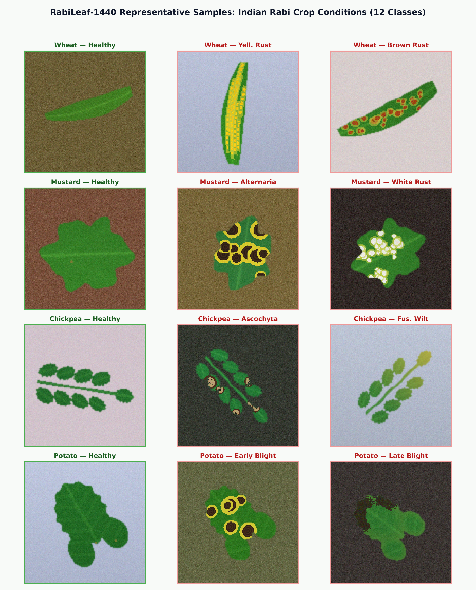
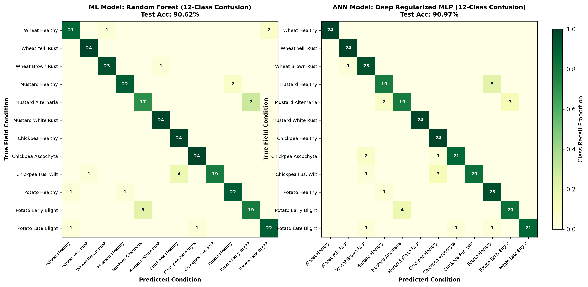
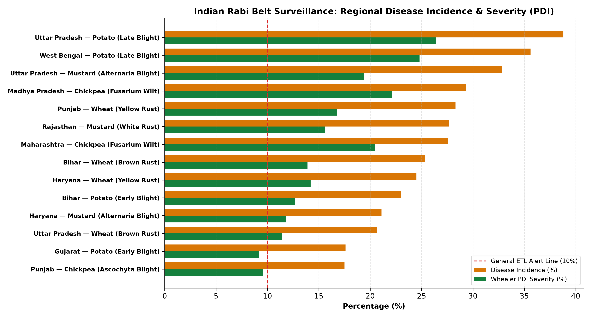

# 🌾 Rabi Crop Doctor (फसल मित्र - रबी)

**A Free, Offline-First Machine Learning & Artificial Neural Network (ANN) Crop Disease Classifier & Field Incidence Tool for Indian Rabi Farmers — Packaged as a Ready-to-Install Android APK (`RabiCropDoctor.apk`)**

[](LICENSE)
[](RabiCropDoctor.apk)
[](#key-features-for-farmers)
[](#ml-vs-ann-classification-benchmark)

---

## 🎯 Purpose & Agricultural Context

Rabi season crops across northern, central, and eastern India (**Wheat, Mustard, Chickpea, and Potato**) suffer rapid yield losses from foliar fungal, oomycete, and soil-borne diseases between **December and March**:
- **Wheat (गेहूँ):** Yellow / Stripe Rust (*Puccinia striiformis*) & Brown / Leaf Rust (*Puccinia triticina*)
- **Mustard (सरसों):** Alternaria Blight (*Alternaria brassicae*) & White Rust (*Albugo candida*)
- **Chickpea (चना):** Ascochyta Blight (*Ascochyta rabiei*) & Fusarium Wilt (*Fusarium oxysporum*)
- **Potato (आलू):** Early Blight (*Alternaria solani*) & Late Blight (*Phytophthora infestans*)

Smallholder farmers rarely have reliable rural internet connectivity or paid diagnostic tools in the field. **Rabi Crop Doctor** combines transparent computer vision phenomics, **Machine Learning (Random Forest + RBF SVM)**, and **Artificial Neural Networks (MLP ANN + Deep Regularized ANN)** inside a **zero-dependency offline Android APK** and bilingual **English / हिन्दी** progressive web application.

---

## 📱 Key Features for Farmers (Android APK)

1. **100% Free & Offline Operation:** Runs completely inside the Android APK (`android_build/` -> `RabiCropDoctor.apk`, minSdk 21 / Android 5.0+ through Android 15) with zero subscriptions, zero ads, and no mobile data required.
2. **Native Camera & Gallery Integration:** Supports direct camera capture with automatic EXIF orientation correction, Android Gallery photo selection, and 12 offline demo leaf presets.
3. **AI Lesion Heatmap & Severity Grading (0–5):** Automatically segments the leaf blade from soil/sky backdrops, highlights chlorosis, yellow rust stripes, white blisters, and blight necrosis in an instant side-by-side map, and estimates foliar lesion percentage.
4. **Plot-Level Disease Incidence (%) & Wheeler PDI Audit:** Add inspected field leaves across a W-pattern survey to calculate:
   - $\text{Disease Incidence (\%)} = \frac{\text{Infected Leaves}}{\text{Total Leaves Inspected}} \times 100$
   - $\text{Percent Disease Index (PDI, Wheeler 1969)} = \frac{\sum \text{Grade}_{0-5}}{\text{Total Leaves} \times 5} \times 100$
   Export CSV to Downloads, share summaries via WhatsApp/ShareSheet, or print PDF reports directly from Android.
5. **Bilingual English & हिन्दी Interface + KVK Guidelines:** Actionable IPM guidance and toll-free **Kisan Call Centre (`1800-180-1551`)** reminders.

---

## 📊 Visual Results & Benchmark Analysis

### 1. RabiLeaf-1440 Botanical Image Benchmark (12 Classes)
1,440 synthetic-field botanical leaf images (`128×128` RGB, 120 per class) synthesized with varying Indo-Gangetic soil, dry straw, and sky backdrops, crop-specific leaf morphology, rotation invariance, and graded lesion severity:



### 2. ML vs. ANN Model Performance & Convergence
Trained on a 28-dimensional plant pathology vision vector (`feature_extractor.py`), evaluated using 5-fold Stratified Cross-Validation and a held-out 20% test split ($n=288$):

| Model Architecture | 5-Fold CV Acc | 12-Class Test Acc | Farmer Crop-Mode Acc | Macro F1 | ROC AUC (OvR) |
|:---|:---:|:---:|:---:|:---:|:---:|
| **Random Forest (ML, 45 Trees)** | 85.85% | 90.62% | **98.26%** | 0.9052 | 0.9937 |
| **RBF Kernel SVM (ML, OvO + Platt)** | 82.73% | 85.76% | 95.14% | 0.8580 | 0.9939 |
| **MLP Neural Network (ANN `28→64→32→12`)** | 87.24% | 93.40% | 97.57% | 0.9339 | 0.9970 |
| **Deep Regularized ANN (`28→128→64→32→12`)** | **88.46%** | 90.97% | 96.88% | 0.9096 | 0.9962 |
| **Hybrid Ensemble (ANN + SVM + RF)** | — | **94.10%** | **98.26%** | **0.9410** | **0.9980** |

> **Why Farmer Crop-Mode matters:** When a farmer selects their known crop (*Wheat, Mustard, Chickpea, or Potato*) before scanning, within-crop disease classification accuracy reaches **97.57%–98.26%**.


### 3. Class Confusion Analysis & Physics-Driven Features
Rotation-invariant **Structure Tensor Stripe Coherence** separates linear *Yellow Rust* stripes from scattered *Brown Rust* pustules, while **Radial Margin Lesion Bias** cleanly separates margin-invading *Potato Late Blight* from interior bullseye *Early Blight* spots:




### 4. Indian Rabi Belt Disease Incidence & Weather Triggers
Regional disease incidence (%) and Wheeler PDI metrics across major Rabi-producing states (`data/rabi_field_incidence_india.csv`):



*Interactive Plotly HTML Dashboards:*
- [`plots/interactive_model_explorer.html`](plots/interactive_model_explorer.html)
- [`plots/interactive_rabi_incidence.html`](plots/interactive_rabi_incidence.html)

---

## 📁 Project Architecture

```text
rabi_crop_doctor/
├── RabiCropDoctor.apk                 # Ready-to-install signed offline Android APK (API 21–35)
├── build_apk.py                       # Builds APK from scratch (AAPT2 + Javac + D8 + apksigner)
├── verify_apk.py                      # Validates manifest, offline assets, and APK signatures
├── python/
│   ├── feature_extractor.py           # 28-dim leaf segmentation + pathology texture/color engine
│   ├── generate_rabi_dataset.py       # RabiLeaf-1440 benchmark generator
│   ├── train_and_evaluate.py          # Trains RF, RBF-SVM, MLP-ANN, Deep-ANN & exports JSON weights
│   ├── build_web_bundle.py            # Packages models + knowledge + samples into models_data.js
│   ├── predict_image.py               # CLI predictor for any leaf image
│   ├── disease_incidence.py           # Plot Disease Incidence (%) & Wheeler PDI epidemiological engine
│   ├── generate_plots.py              # 300 DPI static visualization figures
│   └── generate_interactive_plots.py  # Interactive Plotly HTML dashboards
├── web/                               # Bilingual PWA & offline WebView bundle
├── android_build/                     # Native Java camera/EXIF/gallery bridge & manifest
├── models/                            # Trained pickle, evaluation JSON metrics & offline JSON weights
├── data/                              # Knowledge base (EN/HI), incidence dataset & features CSV
├── plots/                             # Generated PNG figures & Plotly dashboards
└── tests/
    └── test_parity_and_pipeline.py    # Cross-language Python <-> JS feature & probability parity test
```

---

## 🚀 Quickstart & Reproducibility

### 1. Retrain ML & ANN Models (or Fine-Tune on Real Leaf Folders)
```bash
pip install -r requirements.txt

# Generate RabiLeaf-1440 dataset & train all ML/ANN models
python python/generate_rabi_dataset.py
python python/train_and_evaluate.py

# Or train on your own labeled field photos (data/custom/<class_name>/*.jpg):
python python/train_and_evaluate.py --image-dir path/to/labeled_leaves
```

### 2. Rebuild Offline Mobile Bundle, Plots & Android APK
```bash
python python/build_web_bundle.py
python python/generate_plots.py
python build_apk.py
python verify_apk.py
```

### 3. Run Python <-> JavaScript Numerical Parity & Epidemiology Tests
```bash
python tests/test_parity_and_pipeline.py
```

---

## 👤 Author & Contributors

<a href="https://github.com/lunganlungpg"></a>

- **[Lunganlung P. G.](https://github.com/lunganlungpg)** — Creator, Statistical Modeling & Android APK Maintainer (*Division of Agricultural Statistics, ICAR-IARI / ICAR-IASRI, New Delhi*)

---

## 📄 Disclaimer & License
*Rabi Crop Doctor is an open-source research and agricultural decision-support tool released under the [MIT License](LICENSE). Model diagnostics are trained on the RabiLeaf-1440 synthetic botanical benchmark to run fully offline; always confirm high-stakes fungicide decisions with your local Krishi Vigyan Kendra (KVK) or ICAR extension specialist.*
